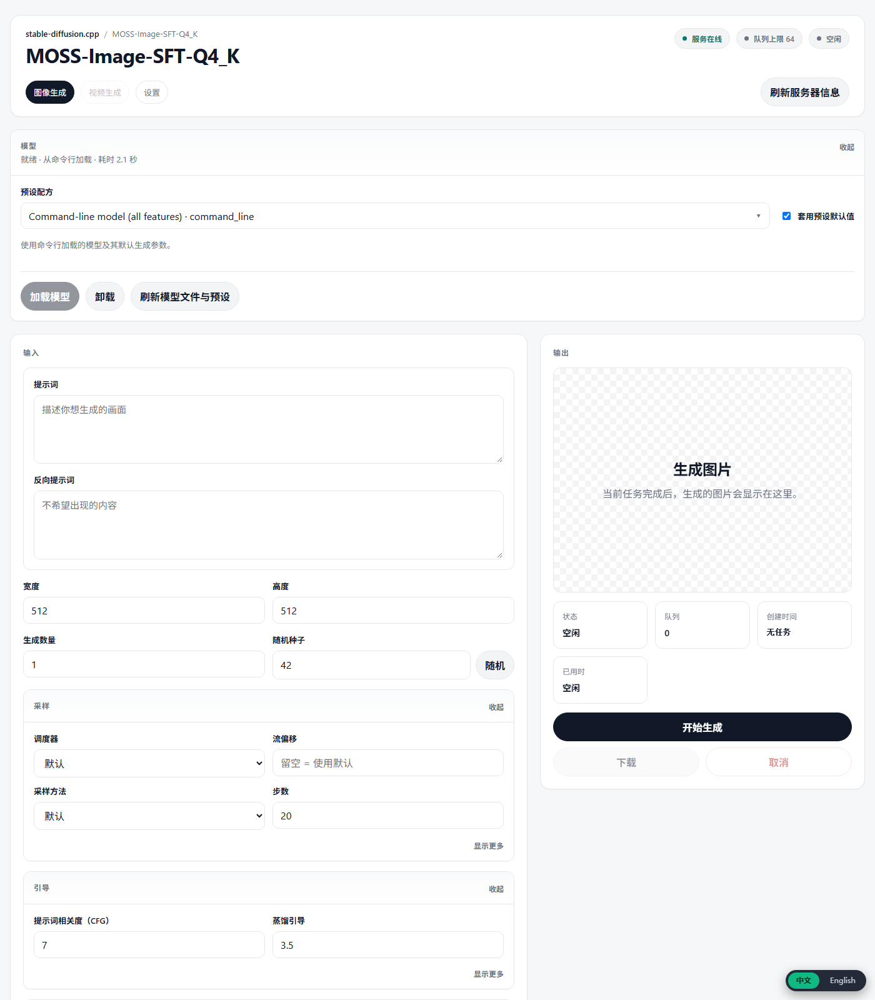

# MOSS-Image Studio

把 **MOSS-Image**（stable-diffusion.cpp 的 GGUF 权重）做成一个像普通软件一样使用的本地生图应用：
中文界面、双击启动、关闭窗口即释放显存，Windows / Linux / macOS 都能跑，手机和平板可以用浏览器接进来。



> 本仓库只包含**启动器 + 中文界面 + 安装脚本**，不包含模型权重和 sd.cpp 二进制。
> 模型约 9.4 GB，由启动器或 `scripts/setup.*` 按需下载；二进制来自 stable-diffusion.cpp 官方 releases（MIT）。

---

## 新手：只下载一个 exe，双击就能用

不需要 git、Python、命令行，也不用先装任何运行库。

1. 打开 [Releases](https://github.com/Ainxin-1/moss-image-studio/releases/latest)，下载 **`MOSS-Image.exe`**（约 210 KB）。
2. 双击它。如果 Windows 弹出 SmartScreen 蓝框，点「**更多信息 → 仍要运行**」（exe 没有代码签名，这是正常提示）。
3. 安装窗口里确认位置（默认 `%LOCALAPPDATA%\MOSS-Image-Studio`，不会弹 UAC），点「**开始下载**」。
4. 等它自己完成：运行库（NVIDIA 约 900 MB，AMD/Intel 约 30 MB，纯 CPU 约 18 MB）+ 4 个模型（约 9.4 GB）。
   下载会拆成 16 段并发，支持断点续传，中途关掉再开也会接着下；界面显示实时速度和剩余时间。
5. 下载完自动启动，并创建桌面快捷方式「**MOSS-Image Studio**」。以后双击快捷方式即可。

- 显卡后端自动判断：有 NVIDIA → CUDA12；AMD/Intel 且系统有 Vulkan → Vulkan；都没有 → CPU。
  想强制指定时运行 `MOSS-Image.exe --backend=cpu`（或 `vulkan` / `cuda12`）。
- 模型默认从 **hf-mirror.com** 下载（国内可直连），失败自动换 huggingface.co；
  运行库直连 GitHub 失败时自动改走 `gh-proxy.com`，并用官方 API 的 size + sha256 校验每个文件。
- 下载约 **10 GB**，安装后占用约 **11 GB**；建议预留 **20 GB** 空闲空间（分段下载需要临时空间）。
  装在桌面/下载文件夹时，程序会自动改到 `%LOCALAPPDATA%`，避免误删。

> 9.4 GB 模型是首次一次性下载。之后每次启动只加载模型，30~90 秒进入界面。

---

## 为什么不是 Python + FastAPI + Nuitka/PyInstaller

结论：**这个项目里没有 Python 需要打包，套一层 FastAPI 只会变慢。**

- `sd-server` 本身就是一个 HTTP 服务，并且已经自带官方 WebUI（`--serve-html-path` 就能托管自定义页面）。再写 FastAPI，等于在端口前面加一个 Python 进程转发请求：能力不变，启动多一秒、内存多几十 MB，还要多维护一套运行时。
- rembg-ui 用 Python 是因为 `rembg` 本身就是 Python 库。这里的推理全在 C++ 的 `sd-server` 里，Python 不参与计算。用 Nuitka/PyInstaller 打包的会是“一个负责拉起子进程、等端口、开窗口”的壳——这件事现在的 exe 用 19 KB 就做完了。
- 真正决定体验的是 9.4 GB 权重加载（30~90 秒）和显存带宽，不是 UI 技术栈。换语言、换打包器都不改变这两项。

**C# 的跨平台问题**也被拆开了：跨平台的部分是 HTML 界面（由 sd-server 提供），启动器只是每个平台一个薄壳——Windows 用 C# WinForms，Linux/macOS 用 100 行 `run.sh`。没有把 WinForms 移植到 Avalonia/MAUI，因为那只是把进程管理代码变重，不会多出任何功能。

---

## 功能

- **一键启动**：双击 `MOSS-Image.exe`，自动拉起服务、等待模型加载、打开无地址栏的应用窗口；关闭窗口即停止服务、释放显存。
- **全中文界面**：官方 WebUI 的完整中文语言包，右下角「中文 / English」随时切换，选择会被记住。
- **完整功能**：文生图、图生图、参考图、蒙版、控制图、LoRA、调度器、步数、CFG、蒸馏引导、批量生成、视频/动态 WebP。
- **局域网访问**：改一个配置项，手机/平板浏览器就能用（同一 WiFi）。
- **配置驱动**：路径、端口、监听地址、额外参数都在 `moss.env` 里，不写死任何本机路径。
- **环境自检**：`MOSS-Image.exe --check` 列出每个文件的实际路径和缺失项。

---

## 图生图默认参数（实测调校）

官方 WebUI 的默认值对「改一张图」很不友好。本仓库的 `web/index.html` 按 32 次受控生成（同一源图、同一提示词、每次只动一个变量）的结果改掉了四个默认值，并加了一条自动分辨率。

| 项 | 官方默认 | 这里 | 依据 |
|---|---|---|---|
| 重绘强度 | 0.75 | **0.60** | 0.75 时 `t_enc` 占采样轨迹 15/16，输出与原图结构无关（SSIM −0.03）；0.70 已崩到 0.38，0.40 又换不动内容 |
| CFG | 7 | **3.5** | 同图同强度下，与原图平均色差 22.2 → 13.8 |
| 步数 | 20 | **30** | 结构保真 0.793 → 0.799（40 步才 0.803），单张 ~29s → ~36s |
| 随机种子 | 固定 42 | **−1（每次随机）** | 固定种子会让人误判「改了参数没反应」 |

**自动分辨率**：往「输入图片（图生图）」里放一张图，界面会按它的宽高比重算输出尺寸（保持短边、长边封顶 1024、对齐 16 的倍数）。不做这一步的话，服务端会把输入图**居中裁成方形**——实测一条 2196×508 的长图被裁到只剩 508 宽，**77% 的像素直接丢弃**，人物身份随之消失。

色差指标：**MAD** = 与原图的平均像素差（0–255，越小越像原图）；**SSIM** = 结构相似度（越接近 1 越像原图）。

---

## 快速开始（从源码 / 想自己控制下载时）

### Windows（NVIDIA 显卡）

```powershell
git clone https://github.com/Ainxin-1/moss-image-studio.git
cd moss-image-studio
powershell -ExecutionPolicy Bypass -File scripts\setup.ps1
```

`setup.ps1` 会做三件事：下载官方 CUDA12 包（含 cuBLAS 运行库）解压到 `bin\`；下载 4 个模型文件到 `models\`（共约 9.4 GB，支持断点续传）；生成 `moss.env`。

然后双击 **`MOSS-Image.exe`**。没有 NVIDIA 显卡时换后端：

```powershell
powershell -ExecutionPolicy Bypass -File scripts\setup.ps1 -Backend vulkan   # AMD / Intel 核显
powershell -ExecutionPolicy Bypass -File scripts\setup.ps1 -Backend cpu      # 纯 CPU，很慢
```

`MOSS-Image.exe` 由 Release 提供；也可以在本机重新编译（Windows 10/11 自带 .NET Framework 4.x）：

```bat
launcher\build.cmd
```

### Linux

```sh
git clone https://github.com/Ainxin-1/moss-image-studio.git
cd moss-image-studio
./scripts/setup.sh --backend=vulkan   # 可选 cpu / vulkan / rocm；默认 cpu
./run.sh
```

`run.sh` 在前台运行：加载完成后自动打开浏览器，`Ctrl+C` 停止服务。没有桌面环境时会打印地址。

### macOS（Apple Silicon）

```sh
./scripts/setup.sh
./run.sh
```

官方只提供 arm64 包。首次运行若被 Gatekeeper 拦截：

```sh
xattr -dr com.apple.quarantine .
```

---

## 手机 / 平板访问

在 `moss.env` 里改两行，然后重启应用：

```ini
MOSS_LISTEN=0.0.0.0
MOSS_STOP_ON_EXIT=0
```

手机连同一个 WiFi，打开 `http://<电脑局域网 IP>:1234`。

- Windows 启动器会在启动完成时显示这个地址 3 秒，并写入 `outputs/lan-url.txt`。
- 界面本身有响应式布局（900px / 720px 断点），390px 宽的手机上是单列可用状态。
- **没有账号和鉴权**，只适合可信局域网，不要把端口映射到公网。

> 手机/边缘设备不跑本地推理：模型 9.4 GB 且需要 GPU。手机的角色是**浏览器客户端**，算力仍在电脑上。这是目前唯一现实的“移动端支持”。

---

## 配置

所有配置都在程序目录的 `moss.env`（从 `moss.env.example` 复制）。同名环境变量优先级更高。

| 配置项 | 默认值 | 说明 |
| --- | --- | --- |
| `MOSS_PORT` | `1234` | 服务端口 |
| `MOSS_LISTEN` | `127.0.0.1` | `0.0.0.0` 允许局域网访问 |
| `MOSS_SERVER` | `bin/sd-server.exe`（Unix 为 `bin/sd-server`） | sd-server 路径 |
| `MOSS_HTML` | `web/index.html` | 中文界面 |
| `MOSS_MODEL_DIR` | `models` | 传给 `--model-dir` |
| `MOSS_DIFFUSION_MODEL` | `models/MOSS-Image-SFT-Q4_K.gguf` | DiT，约 3.3 GB |
| `MOSS_TEXT_ENCODER` | `models/text_encoders/Qwen3.5-9B-Q4_K_M.gguf` | 文本编码器，约 5.7 GB |
| `MOSS_VAE` | `models/vae/flux2-vae.safetensors` | FLUX.2 VAE，约 0.34 GB |
| `MOSS_TOKENIZER` | `models/tokenizers/tokenizer.json` | tokenizer |
| `MOSS_OFFLOAD_TO_CPU` | `1` | 显存不足时把部分权重放内存 |
| `MOSS_STOP_ON_EXIT` | `1` | 关闭窗口后是否停止服务 |
| `MOSS_EXTRA_ARGS` | 空 | 追加给 sd-server 的参数 |

相对路径以程序目录为基准，也接受绝对路径和 `~/`。

模型文件不在默认位置时，只需改 `MOSS_*` 四行指向实际文件，不必移动文件。

---

## 目录结构

```
MOSS-Image.exe          启动器（Release 提供；launcher/build.cmd 可重新编译）
run.sh                  Linux / macOS 启动脚本
moss.env.example        配置模板
launcher/Launcher.cs    启动器源码（C# 5，单文件，无第三方依赖）
launcher/build.cmd      编译脚本
scripts/setup.ps1       Windows 环境准备
scripts/setup.sh        Linux / macOS 环境准备
web/index.html          官方 WebUI + 中文语言包
docs/                   截图
bin/                    sd-server 及运行库（setup 下载，不入库）
models/                 模型权重（setup 下载，不入库）
downloads/              下载缓存（不入库）
outputs/                日志、生成结果、lan-url.txt（不入库）
```

启动器做的事只有四件：读配置、拉起 `bin/sd-server`、轮询端口直到返回 200、打开应用窗口。它不参与推理，也不是把 9.4 GB 模型打进 exe。

---

## 实测与未实测

**在本机实测通过（Windows 11 + RTX 4060 Laptop 8 GB）：**

- 双击启动 → 加载 → 打开应用窗口；关闭窗口后 `sd-server` 与启动器均退出，端口释放。
- **单 exe 安装器（v0.1.1，CPU 后端）端到端跑通**：GitHub 直连失败后自动切 `gh-proxy.com` 下完
  17.9 MB 运行库 → 按官方 API 的 size + sha256 校验（`402f2c95…`）→ 解压出 `bin\sd-server.exe`；
  再从 hf-mirror 实下 tokenizer（17 MB，JSON 内容正确）；模型已在位时正确跳过。
- `--check` 正确列出路径与缺失项。
- `MOSS_LISTEN=0.0.0.0` 时监听 `0.0.0.0:1234`，用局域网 IP `http://192.168.x.x:1234` 请求返回 200，并生成 `outputs/lan-url.txt`。
- 中文界面全量翻译、动态状态文本、中英切换与记忆。
- **调校后的默认值在浏览器里实测确认**：重绘强度 0.6、步数 30、CFG 3.5、随机种子 −1；由界面自己发起的一次生成，服务端日志给出 `target t_enc is 18 steps`（18/30 = 0.60），连续两次生成的种子不同（2644、3157）。
- **自动分辨率实测四种输入**：300×450 → 512×768、900×200 → 1024×224、200×900 → 224×1024、400×400 → 保持 512×512。
- 性能参考：512×512 / 20 步约 32 秒，50 步约 53 秒。

**未实测：**

- **CUDA12 分支的完整下载**（343 MB 运行库 + 563 MB cudart）没有在本机从零跑过；本机现有的 CUDA 运行库就是这两包解压来的，CUDA 推理已实测。
- **3 个 GB 级模型**的安装器下载没有从零跑完（测试时用等长占位文件触发了跳过逻辑）；模型 URL、hf-mirror 可达性和断点续传逻辑均已单独验证。
- Linux / macOS 的 `run.sh` 与 `setup.sh`：本机没有对应系统，未端到端执行。包名和下载地址已用 GitHub API 核对到当前最新 release。
- `scripts/setup.ps1` 的完整下载流程：模型与官方包已在别处验证过可下载，但脚本本身没有从零跑完一次 9.4 GB。
- DiT 权重地址来自本机 LM Studio 的下载元数据（`leejet/MOSS-Image-SFT-GGUF`）。发布时 huggingface.co 在本机无法访问，未能再次校验该 URL；如果失效，换任意 MOSS-Image Q4_K GGUF 并改 `MOSS_DIFFUSION_MODEL` 即可。

---

## 已知限制

- 模型需要约 9.4 GB 磁盘和一块像样的 GPU；纯 CPU 可以跑但很慢。
- 界面是官方 WebUI 的快照 + 语言包。sd.cpp 更新 WebUI 后，需要重新取官方页面并重新适配语言包。
- 不要点界面里的「卸载模型 / Unload」：模型由命令行参数加载，不在 `models` 目录里扫描，卸载后只能重启恢复。
- **「参考图」和「IP-Adapter 图片」这两个上传框当前对本模型不生效，而且一旦填了，服务端会直接丢掉图生图的初始图**，输出退化成纯文生图（实测三次，与「不填初始图」的结果像素级相同）。改图只用「输入图片（图生图）」。
- leejet 发布的 GGUF 是 stable-diffusion.cpp 专用格式，不能给 LM Studio / llama.cpp 用。
- 服务无鉴权、无 TLS，只用于本机或可信局域网。

---

## 许可

本仓库代码 MIT，见 [LICENSE](LICENSE)。第三方组件、模型与素材的归属见 [NOTICE](NOTICE)。
模型权重不随仓库分发，使用前请阅读对应模型卡片的许可条款。

---

## English

MOSS-Image Studio is a thin, cross-platform launcher for [MOSS-Image](https://huggingface.co/OpenMOSS-Team/MOSS-Image-Base) running on [stable-diffusion.cpp](https://github.com/leejet/stable-diffusion.cpp). It ships a full Chinese localization of the official WebUI, a 19 KB Windows launcher, and shell scripts for Linux/macOS. Model weights (~9.4 GB) and the `sd-server` binary are downloaded by `scripts/setup.*`, not committed to this repository.

No Python runtime is involved: `sd-server` already serves the HTTP API and the WebUI, so an extra FastAPI layer would only add a process and latency. Phones and tablets connect through a browser over LAN (`MOSS_LISTEN=0.0.0.0`); inference stays on the host GPU.

MIT licensed. Third-party notices in [NOTICE](NOTICE).
